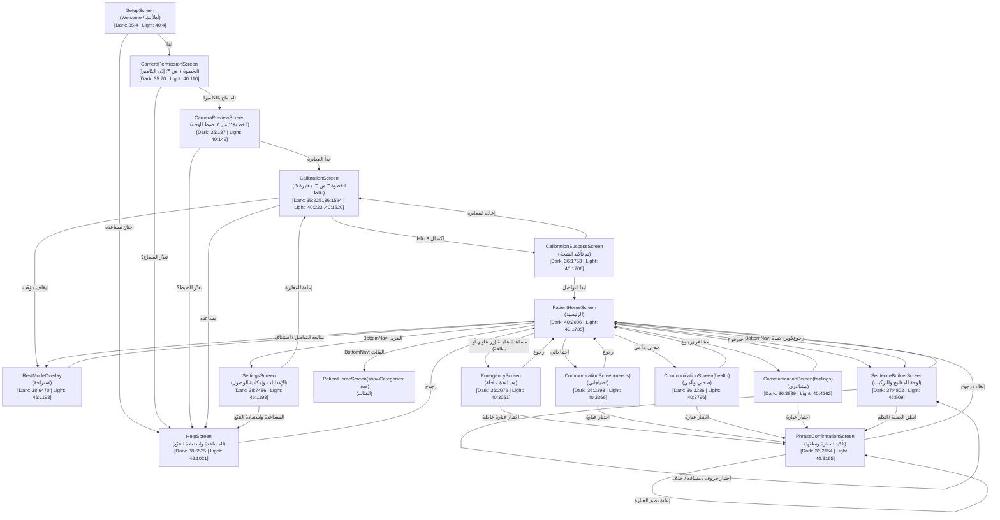

# Lock-In Patient App — Complete Navigation Architecture

## 1. Overview & Flowchart

The following Mermaid diagram maps the complete, Figma-verified user journey of the Lock-In Patient App, including onboarding, 9-point calibration, dashboard, communication categories, phrase confirmation dialogs, gaze-keyboard composer, rest mode overlay, and settings.

---

## 2. Figma Frame to Flutter Screen Mapping

| Screen / Flow | Dark Frame ID | Light Frame ID | Flutter Screen / Component | Entry Action | Next Screen / Action | Status |
| :--- | :---: | :---: | :--- | :--- | :--- | :---: |
| **Welcome / Onboarding** | `35:4` | `40:4` | `SetupScreen` (`/`) | App Launch | `ابدأ` &rarr; Camera Step 1 (`/camera`) `أحتاج مساعدة` &rarr; `HelpScreen` (`/help`) | Partially Implemented (Fixing single-column landscape layout) |
| **Step 1: Camera Permission** | `35:70` | `40:110` | `CameraPermissionWidget` (`/camera`) | `ابدأ` from Welcome | `السماح بالكاميرا` &rarr; Step 2 `تعذّر السماح؟` &rarr; `HelpScreen` | Partially Implemented |
| **Step 2: Face Positioning & Preview** | `35:187` | `40:149` | `CameraPreviewScreen` (`/camera`) | Camera Allowed | `ابدأ المعايرة` &rarr; Step 3 (`/calibration`) `تعذّر الضبط؟` &rarr; `HelpScreen` | Partially Implemented (Fixing 360x340 frame & face oval guide) |
| **Step 3: 9-Point Calibration** | `35:225`..`36:1594` | `40:223`..`40:1520` | `CalibrationScreen` (`/calibration`) | `ابدأ المعايرة` from Step 2 | Dwell 9 targets sequentially &rarr; Calibration Success `مساعدة` &rarr; `HelpScreen` `إيقاف مؤقت` &rarr; Rest Mode | Needs Visual Alignment (Adding 3x3 layout & step indicator) |
| **Calibration Success** | `36:1753` | `40:1706` | `CalibrationSuccessView` | 9 points completed | `ابدأ التواصل` &rarr; `PatientHomeScreen` (`/dashboard`) `إعادة المعايرة` &rarr; Restart Calibration | Missing State |
| **Patient Home (Dashboard)** | `40:2006` | `40:1735` | `PatientHomeScreen` (`/dashboard`) | Calibration success or BottomNav | Cards: Needs, Health, Feelings, Composer, Rest, Emergency | Implemented (Fixing responsive header/urgent position) |
| **Categories Overview** | `40:2006` (tab 2) | `40:1735` (tab 2) | `PatientHomeScreen(showCategories: true)` (`/categories`) | BottomNav `الفئات` | Opens Category details | Implemented |
| **Emergency Help** | `36:2079` | `40:3051` | `EmergencyScreen` (`/emergency`) | Top bar / Emergency Card | Phrase selection &rarr; `PhraseConfirmationScreen` | Implemented (Connecting to confirmation screen) |
| **Category: احتياجاتي (My Needs)** | `36:2398` | `40:3366` | `CommunicationScreen(category: 'needs')` | Dashboard / Categories | Option selection &rarr; `PhraseConfirmationScreen` | Needs Phrase Confirmation transition |
| **Category: صحتي وألمي (Health & Pain)** | `36:3236` | `40:3796` | `CommunicationScreen(category: 'health')` | Dashboard / Categories | Option selection &rarr; `PhraseConfirmationScreen` | Needs Phrase Confirmation transition |
| **Category: مشاعري (My Feelings)** | `36:3889` | `40:4262` | `CommunicationScreen(category: 'feelings')` | Dashboard / Categories | Option selection &rarr; `PhraseConfirmationScreen` | Needs Phrase Confirmation transition |
| **تأكيد العبارة (Phrase Confirmation)** | `36:2154`, `36:2696`.. | `40:3165`, `40:3545`.. | `PhraseConfirmationScreen` (`/confirmation`) | Selecting any phrase/need/emotion | `إعادة نطق العبارة` &rarr; Speaks TTS again `إلغاء` &rarr; Returns to previous screen | **Missing Screen (To Implement)** |
| **لوحة المفاتيح والتركيب (Gaze Keyboard)** | `37:4802` | `46:509` | `SentenceBuilderScreen` (`/composer`) | Dashboard card / BottomNav | Dwell on Arabic keys &rarr; appends letter `حذف` &rarr; removes letter `مسافة` &rarr; adds space `اتكلم` &rarr; `PhraseConfirmationScreen` | Needs Figma Virtual Keyboard implementation |
| **خذ وقتك وارتاح (Rest Mode Overlay)** | `38:6470` / `38:6499` | `46:1021` | `RestModeOverlay` (Global Overlay) | `استراحة` card or Dwell on Rest | `متابعة التواصل` (Resume card) &rarr; Dismisses overlay | Implemented (Refining styling to match Figma) |
| **المساعدة واستعادة التتبّع** | `38:6525`..`38:7402` | `46:1021` | `HelpScreen` (`/help`) | Top bar help icon or settings | Troubleshooting options & recovery routes | Implemented |
| **الإعدادات وإمكانية الوصول** | `38:7486` / `38:7752` | `46:1198` | `SettingsScreen` (`/settings`) | BottomNav `المزيد` | Theme toggle, Dwell time, Speech rate, Recalibration | Implemented |

---

## 3. Calibration 9-Point Progression Reference

In Figma, the calibration flow is broken down into 10 explicit frame states covering the progression of the 3x3 grid:

| Stage | Active Target | Dark Frame ID | Light Frame ID | Status Badge Text | Next State |
| :---: | :---: | :---: | :---: | :--- | :--- |
| **0** | Target 1 (Top-Left) | `35:225` | `40:223` | "تم تسجيل 0 من ٩ نقاط" | Dwell 1.5s &rarr; Stage 1 |
| **1** | Target 2 (Top-Center) | `36:436` | `40:360` | "تم تسجيل 1 من ٩ نقاط" | Dwell 1.5s &rarr; Stage 2 |
| **2** | Target 3 (Top-Right) | `36:572` | `40:496` | "تم تسجيل 2 من ٩ نقاط" | Dwell 1.5s &rarr; Stage 3 |
| **3** | Target 4 (Middle-Left) | `36:712` | `40:638` | "تم تسجيل 3 من ٩ نقاط" | Dwell 1.5s &rarr; Stage 4 |
| **4** | Target 5 (Center) | `36:856` | `40:778` | "تم تسجيل 4 من ٩ نقاط" | Dwell 1.5s &rarr; Stage 5 |
| **5** | Target 6 (Middle-Right) | `36:998` | `40:924` | "تم تسجيل 5 من ٩ نقاط" | Dwell 1.5s &rarr; Stage 6 |
| **6** | Target 7 (Bottom-Left) | `36:1144` | `40:1070` | "تم تسجيل 6 من ٩ نقاط" | Dwell 1.5s &rarr; Stage 7 |
| **7** | Target 8 (Bottom-Center) | `36:1294` | `40:1218` | "تم تسجيل 7 من ٩ نقاط" | Dwell 1.5s &rarr; Stage 8 |
| **8** | Target 9 (Bottom-Right) | `36:1444` | `40:1368` | "تم تسجيل 8 من ٩ نقاط" | Dwell 1.5s &rarr; Stage 9 |
| **9** | All 9 Recorded | `36:1594` | `40:1520` | "تم تسجيل نقاط المعايرة" | Verification &rarr; Success State |
| **Success** | Complete State | `36:1753` | `40:1706` | "✓ تم تأكيد النتيجة / المعايرة جاهزة" | "ابدأ التواصل" &rarr; Dashboard (`/dashboard`) |

---

## 4. Bottom Navigation & Subcategory Flow Specifications

### A. Bottom Navigation Destinations
1. **الرئيسية (`dashboard`):** Maps to `PatientHomeScreen()`.
2. **الفئات (`categories`):** Maps to `PatientHomeScreen(showCategories: true)`.
3. **تكوين جملة (`composer`):** Maps to `SentenceBuilderScreen()`.
4. **المزيد (`settings`):** Maps to `SettingsScreen()`.

### B. Category Phrase Catalogs & Confirmation Mappings
Each category has 6 predefined phrases in Figma. Selecting any phrase triggers immediate navigation to `PhraseConfirmationScreen` with that phrase:
- **احتياجاتي (`needs`):**
  1. عايز اشرب مية
  2. عايز أكل
  3. عايز أغيّر وضعي
  4. عايز أرتاح
  5. عايز أغيّر المكان
  6. محتاج الحمّام
- **صحتي وألمي (`health`):**
  1. عندي ألم شديد
  2. محتاج مسكن
  3. عندي ضيق تنفس
  4. عايز أقيس الضغط
  5. حاسس بدوخة
  6. عايز دكتور
- **مشاعري (`feelings`):**
  1. أنا مبسوط
  2. أنا قلقان
  3. أنا تعبان
  4. أنا زهقان
  5. أنا متوتر
  6. شكراً لكم
- **مساعدة عاجلة (`emergency`):**
  1. محتاج مساعدة حالًا
  2. أنا بتألم
  3. نادِ المرافق
